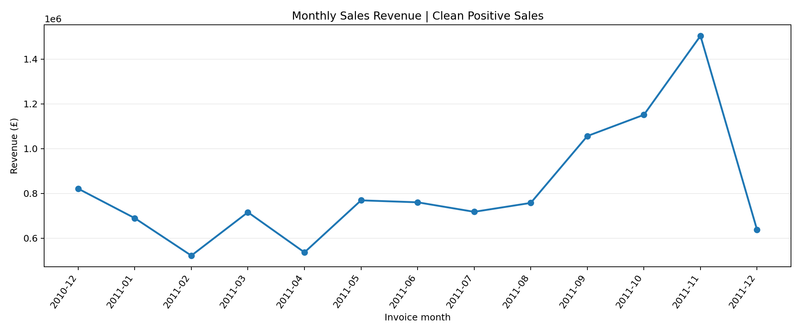
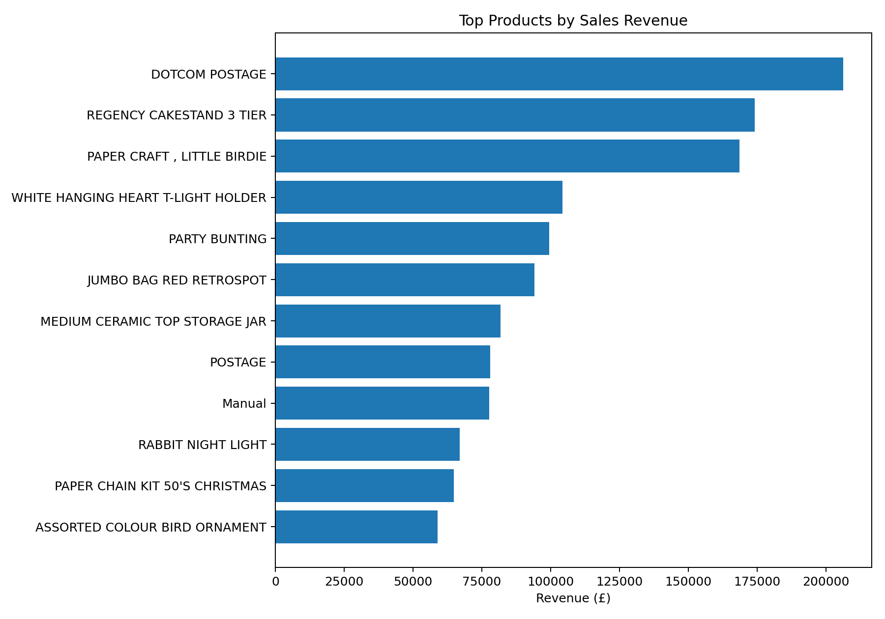
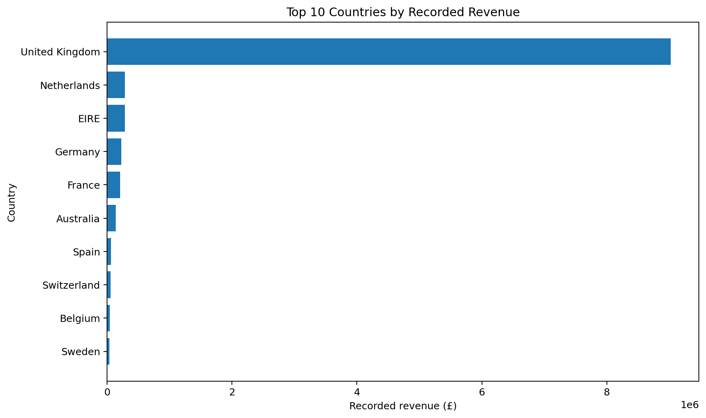
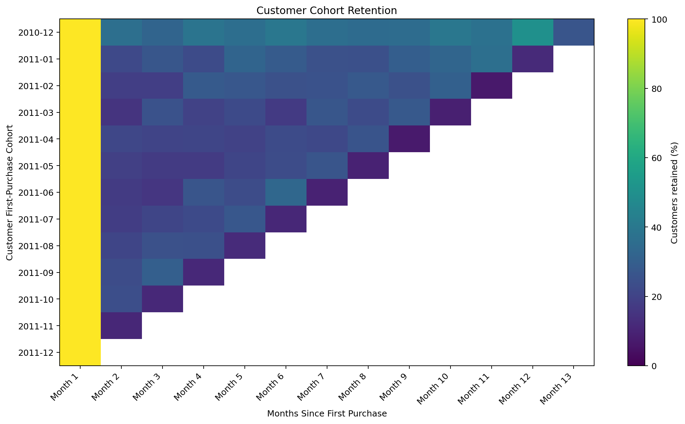
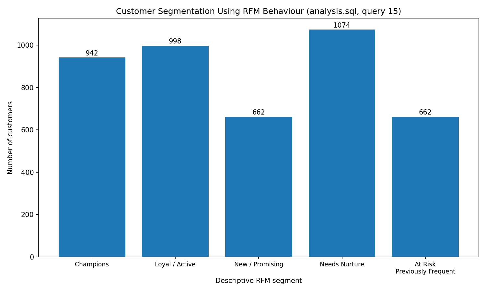

# 📊 Project Visualizations & Business Insights

## Enterprise SQL Intelligence & Customer Retention Analytics

**Dataset:** UCI Online Retail  
**Period:** December 2010 – December 2011  
**Analysis:** Sales Performance | Customer Retention | Revenue Intelligence

This page presents the visual outputs of my SQL-based retail analytics project. Each visualization addresses a business question and supports further investigation of sales and customer behaviour.

---

## 1. Monthly Revenue Analysis

**Business question:** How did recorded sales revenue change over time?

**What this visualization helps investigate:**
- Monthly revenue fluctuations.
- Periods with relatively high or low sales.
- Changes that may warrant further analysis.

**Business relevance:** Monthly revenue trends help analysts identify periods that deserve closer examination. Additional data is required to explain the causes of increases or decreases.

---

## 2. Product Revenue Performance

**Business question:** Which products contributed the most recorded revenue?

**What this visualization helps investigate:**
- Products with the highest revenue contribution.
- Differences in revenue across products.
- Products that may warrant further commercial analysis.

**Business relevance:** Product revenue rankings can support product-performance reviews. Profitability decisions require additional information such as product costs, discounts, and returns.

---

## 3. Revenue by Country

**Business question:** Which countries contributed the most recorded sales revenue?

**What this visualization helps investigate:**
- Geographic revenue distribution.
- The contribution of the United Kingdom.
- Differences in sales volume across countries.

**Business relevance:** Geographic analysis can help identify markets for further investigation. These historical results should not be treated as a representation of current market demand.

---

## 4. Customer Cohort Retention

**Business question:** How many customers from each first-purchase cohort continued purchasing in subsequent months?

**What this visualization helps investigate:**
- Repeat purchasing after the first recorded purchase.
- Changes in observed retention across cohorts.
- Differences in retention at comparable cohort ages.

**Business relevance:** Cohort analysis provides a structured way to understand historical customer activity and identify questions for further retention analysis.

**Interpretation note:** Later cohorts have shorter observation periods. Blank cells indicate months that are not observable in the dataset, not zero retention.

---

## 5. RFM Customer Segmentation

**Business question:** How can customers be grouped according to their observed purchasing behaviour?

RFM represents three dimensions:

- **Recency:** How recently a customer purchased.
- **Frequency:** How many distinct invoices are associated with the customer.
- **Monetary:** Total recorded customer revenue.

**What this visualization helps investigate:**
- Differences in observed customer activity.
- Customers with relatively recent and frequent purchases.
- Customer groups that may warrant further analysis.

**Business relevance:** RFM segmentation helps organise historical customer behaviour into interpretable groups. The segments are descriptive, not predictions of future purchasing behaviour.

---

## Key Analytical Considerations

- Revenue is calculated as quantity multiplied by unit price and represents recorded sales, not profit.
- Customer-level analyses exclude transactions without an identified customer ID.
- Returns and cancellations must be handled consistently with the documented data-preparation rules.
- The observation period covers December 2010 through December 2011.
- Visual patterns describe historical behaviour and do not establish causation.

---

## Tools and Techniques

**SQL | Data Cleaning | Aggregation | Window Functions | Revenue Analysis | Cohort Retention | RFM Segmentation | Business Interpretation**

---

## Project Objective

The objective is to demonstrate how structured SQL analysis can transform retail transaction records into measurable sales and customer insights, while documenting assumptions and limitations clearly.
